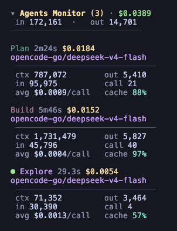

# @alvarovfon/opencode-agent-monitor

[](https://www.npmjs.com/package/@alvarovfon/opencode-agent-monitor)
[](LICENSE)
[](https://github.com/AlvaroVFon/opencode-agent-monitor/actions/workflows/ci.yml)

Real-time TUI monitor, JSONL tracing plugin, and CLI metrics tool for OpenCode. Track LLM calls, agent delegations, tool calls, and session events with live cost breakdowns per agent and model.

## Live TUI Monitor



Real-time sidebar panel that shows per-agent cost, context tokens, call stats, and errors — updated live as OpenCode runs.

## Installation

Requires **OpenCode V2** (`@opencode/plugin` 2.x). V1 users should stay on the `1.x` release line.

### Via OpenCode (recommended)

```bash
opencode plugin add @alvarovfon/opencode-agent-monitor
```

This registers the package in `~/.config/opencode/opencode.json`. The TUI
plugin ships in the same package through the `./tui` export and loads
automatically:

```json
{
  "$schema": "https://opencode.ai/config.json",
  "plugins": ["@alvarovfon/opencode-agent-monitor"]
}
```

To pass options (for example a custom trace directory), use the object form:

```json
{
  "$schema": "https://opencode.ai/config.json",
  "plugins": [
    {
      "package": "@alvarovfon/opencode-agent-monitor",
      "options": { "traceDir": "/home/me/.tracing" }
    }
  ]
}
```

When the TUI runs against a remote server, or when you want the monitor active
without the server plugin, add it to `~/.config/opencode/cli.json`:

```json
{
  "plugins": ["@alvarovfon/opencode-agent-monitor"]
}
```

### Features

- **Sidebar panel** — agents sorted by cost descending. Each row shows cost, per-model breakdown, context tokens (input/output), call count, cache hit rate, average cost per call, and error count. The currently active agent is marked with a dot.
- **Fullscreen panel** — press `Ctrl+A` to toggle an expanded table with totals and per-model breakdown.
- **HTML Dashboard export** — generate a self-contained HTML report with cost, tokens, tools/skills, timeline, errors, and event metrics panels, with light/dark theming.
- **Per-session isolation** — each OpenCode session writes to its own `{sessionId}.jsonl` file. No single-file contention, natural log rotation.
- **Per-session persistent cursor** — each session's file cursor survives TUI restarts via the plugin storage, so you never miss events between sessions.

The trace directory is read from the same `traceDir` option used in the server plugin config (default: `~/.config/opencode/.tracing`). Each session produces one file named `{safeSessionId}.jsonl`.

## Schema Evolution

Every event includes a `schemaVersion` field. OpenCode V2 emits `schemaVersion: 2`.

- **Minor changes (Additive):** New fields can be added to existing events without bumping the major version.
- **Major changes (Breaking):** If fields are renamed or removed, the `schemaVersion` will be incremented.
- **Migration Policy:** The CLI and TUI are designed to handle multiple schema versions where feasible, but we recommend keeping the package updated to ensure full compatibility.

### Migrating from 1.x (OpenCode V1)

Version 2.0.0 ports the plugin to the OpenCode V2 plugin API:

- `plugin` became `plugins` and the package object form is supported.
- The TUI plugin is now loaded from the same package; `tui.json` was replaced by `cli.json`.
- Trace files now carry `schemaVersion: 2`. Existing `1.x` files stay readable by the CLI.
- The `Ctrl+A` view is now a native session panel.

Keep using `1.x` if you are still on OpenCode V1: V1 plugin implementations do
not run in V2.

## CLI Usage

### Quick start (no install)

```bash
npx @alvarovfon/opencode-agent-monitor stats
npx @alvarovfon/opencode-agent-monitor stats --since 24h --top 5 --json
npx @alvarovfon/opencode-agent-monitor errors --since 7d --limit 10
npx @alvarovfon/opencode-agent-monitor export --since 30d --format markdown
npx @alvarovfon/opencode-agent-monitor compare --since 24h
```

### Global install

```bash
npm install -g @alvarovfon/opencode-agent-monitor
agent-monitor stats
```

Five subcommands (`stats`, `errors`, `export`, `compare`, `dashboard`). Full reference in [`src/cli/README.md`](src/cli/README.md).

## Components

The project ships three components that share the same per-session `.jsonl` format:

- **Server plugin** — traces OpenCode events to JSONL. Configuration, event tables, and output format in [`src/server/README.md`](src/server/README.md).
- **TUI plugin** — live sidebar monitor with fullscreen dialog. Installation, keybindings, and architecture in [`src/tui/README.md`](src/tui/README.md).
- **CLI** — extract and analyze metrics from trace files. Subcommands, flags, and examples in [`src/cli/README.md`](src/cli/README.md).

## Local Development

```bash
git clone https://github.com/AlvaroVFon/opencode-agent-monitor.git
cd opencode-agent-monitor
pnpm install --ignore-scripts
pnpm build
pnpm test:prod
```

OpenCode V2 requires configured local plugins to be directories, so
`pnpm test:prod` generates wrapper directories under
`~/.config/opencode/.agent-monitor-prod/` and points
`~/.config/opencode/opencode.json` (server) and
`~/.config/opencode/cli.json` (TUI) at them. Run `pnpm test:prod --restore` to
revert.

Alternatively, drop `dist/agent-monitor.js` into `.opencode/plugins/` for the
server side; OpenCode discovers direct files there.

## License

MIT
